<picture>
  <source media="(prefers-color-scheme: dark)" srcset="./assets/hero-dark.svg">
  <source media="(prefers-color-scheme: light)" srcset="./assets/hero-light.svg">
  
</picture>

  <a href="https://www.linkedin.com/in/ayubifathan"><picture><source media="(prefers-color-scheme: dark)" srcset="./assets/pills/linkedin-dark.svg"><source media="(prefers-color-scheme: light)" srcset="./assets/pills/linkedin-light.svg"></picture></a>&nbsp;
  <a href="mailto:ayubi300306@gmail.com"><picture><source media="(prefers-color-scheme: dark)" srcset="./assets/pills/email-dark.svg"><source media="(prefers-color-scheme: light)" srcset="./assets/pills/email-light.svg"></picture></a>&nbsp;
  <a href="https://agrisymphony.com/"><picture><source media="(prefers-color-scheme: dark)" srcset="./assets/pills/agrisymphony-dark.svg"><source media="(prefers-color-scheme: light)" srcset="./assets/pills/agrisymphony-light.svg"></picture></a>&nbsp;
  <a href="https://devpost.com/software/taniplus"><picture><source media="(prefers-color-scheme: dark)" srcset="./assets/pills/taniplus-dark.svg"><source media="(prefers-color-scheme: light)" srcset="./assets/pills/taniplus-light.svg"></picture></a>&nbsp;
  <a href="https://github.com/Zaddyyubiii?tab=repositories"><picture><source media="(prefers-color-scheme: dark)" srcset="./assets/pills/repositories-dark.svg"><source media="(prefers-color-scheme: light)" srcset="./assets/pills/repositories-light.svg"></picture></a>

## About & Current Roles

<table>
  <tr>
    <td valign="top" width="58%">
      

        I am a Computer Science undergraduate at IPB University working across UI/UX design and frontend development. My work focuses on turning user needs into structured digital products through UX research, user flows, wireframing, prototyping, and web implementation.
      

      

        Outside coursework, I design campus-scale platforms and visual systems for student orientation and organizational teams, bridging product design with engineering execution.
      

    </td>
    <td valign="top" width="42%">
      
<strong>OMB IPB 63</strong> Information Systems, Communication &amp; Visual (Dec 2025 - Present)

      
<strong>HIMALKOM IPB</strong> Talent &amp; Development, Lead Organizer of I-CONVO Podcast (Jan 2026 - Present)

      
<strong>IPB University</strong> B.Sc. Computer Science (2024 - 2028)

    </td>
  </tr>
</table>

## Featured Project

<table>
  <tr>
    <td width="58%" valign="middle">
      
    </td>
    <td width="42%" valign="top">
      
      <h3><a href="https://agrisymphony.com/">Agrisymphony 2026</a></h3>
      
<strong>UI/UX Designer</strong> | Mar 2026 - Aug 2026

      

        Designed the user interface and experience for IPB University's annual festival and student orientation platform, structuring event navigation (About, Schedule, Gallery, Emergency, and Store) into clear, responsive web flows.
      

      
Information Architecture · User Flows · Responsive UI

      
    </td>
  </tr>
</table>

## Selected Work

### Product & UI/UX

| Project | Context | Contribution |
| --- | --- | --- |
| [**TaniPlus**](https://devpost.com/software/taniplus) | Garuda Hacks 7.0 (Jul - Aug 2026) | Designed UI/UX, user flows, and wireframes for an IoT precision agriculture platform turning sensor and soil metrics into clear farmer actions. |
| **MySOC & StudentOrientation** | OMB IPB 63 (Jan - Jul 2026) | Built interface components, user flows, and wireframes to organize orientation schedules and campus services for new IPB University students. |
| **IPB Preloved** | Campus Marketplace (Jan - Jun 2026) | Designed browsing, search, and product discovery flows for a student second-hand marketplace. |
| **OrmawaEksekutif.com & Sakarsakos.com** | Ormawa Eksekutif PKU IPB (Dec 2024 - Aug 2025) | Created website layouts, visual assets, and UI components for student organization profiling and student housing discovery. |

### Code Repositories

- [`Proyek-Analisis-Data-Asah-by-Dicoding-`](https://github.com/Zaddyyubiii/Proyek-Analisis-Data-Asah-by-Dicoding-) (Jupyter Notebook, Python): Data analysis project built for Asah by Dicoding.
- [`Ular-Tangga-IPB`](https://github.com/Zaddyyubiii/Ular-Tangga-IPB) (C#, WebGL, [Live Demo](https://zaddyyubiii.github.io/Ular-Tangga-IPB/)): Interactive campus-themed board game deployed on GitHub Pages.
- [`Project-Akhir-Metkuan`](https://github.com/Zaddyyubiii/Project-Akhir-Metkuan) (R): Quantitative methods final analysis repository.
- [`rumah_sakit_crud`](https://github.com/Zaddyyubiii/rumah_sakit_crud) (PHP): Hospital records CRUD web application.

## Toolkit & Tech Stack

<table>
  <tr>
    <td valign="top" width="34%">
      <h4>Design &amp; UX</h4>
      

        
        
        
        
        
        
        
        
        
      

    </td>
    <td valign="top" width="33%">
      <h4>Languages</h4>
      

        
        
        
        
        
        
      

    </td>
    <td valign="top" width="33%">
      <h4>Development</h4>
      

        
        
        
        
      

    </td>
  </tr>
</table>

## Live GitHub Activity

<picture>
  <source media="(prefers-color-scheme: dark)" srcset="./assets/github-snapshot-dark.svg">
  <source media="(prefers-color-scheme: light)" srcset="./assets/github-snapshot-light.svg">
  
</picture>

  Synced daily via GitHub Actions from public repository data.

  Open to UI/UX design and frontend collaboration: <a href="https://www.linkedin.com/in/ayubifathan">LinkedIn</a> · <a href="mailto:ayubi300306@gmail.com">Email</a>

