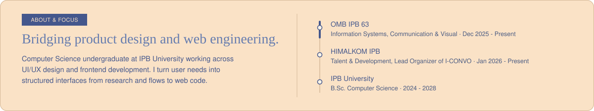
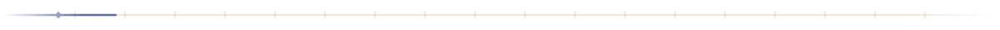
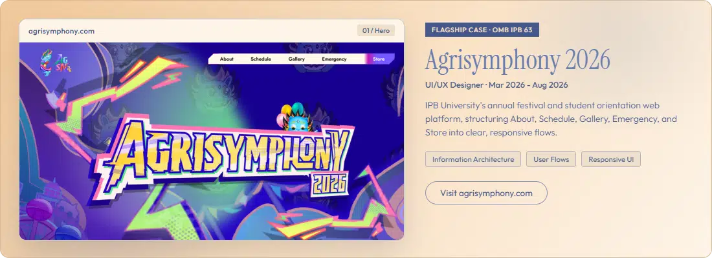
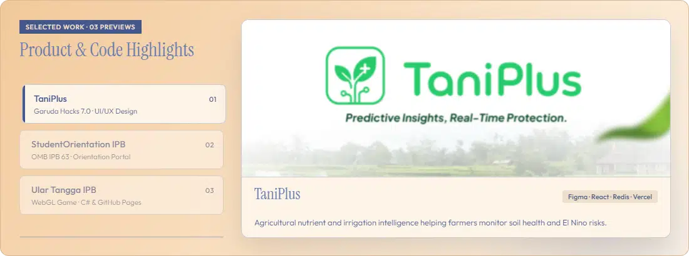

<picture>
  <source media="(prefers-color-scheme: dark)" srcset="./assets/hero-dark.webp">
  <source media="(prefers-color-scheme: light)" srcset="./assets/hero-light.webp">
  
</picture>

  <a href="https://www.linkedin.com/in/ayubifathan"><picture><source media="(prefers-color-scheme: dark)" srcset="./assets/pills/linkedin-dark.svg"><source media="(prefers-color-scheme: light)" srcset="./assets/pills/linkedin-light.svg"></picture></a>&nbsp;
  <a href="mailto:ayubi300306@gmail.com"><picture><source media="(prefers-color-scheme: dark)" srcset="./assets/pills/email-dark.svg"><source media="(prefers-color-scheme: light)" srcset="./assets/pills/email-light.svg"></picture></a>&nbsp;
  <a href="https://agrisymphony.com/"><picture><source media="(prefers-color-scheme: dark)" srcset="./assets/pills/agrisymphony-dark.svg"><source media="(prefers-color-scheme: light)" srcset="./assets/pills/agrisymphony-light.svg"></picture></a>&nbsp;
  <a href="https://devpost.com/software/taniplus"><picture><source media="(prefers-color-scheme: dark)" srcset="./assets/pills/taniplus-dark.svg"><source media="(prefers-color-scheme: light)" srcset="./assets/pills/taniplus-light.svg"></picture></a>&nbsp;
  <a href="https://github.com/Zaddyyubiii?tab=repositories"><picture><source media="(prefers-color-scheme: dark)" srcset="./assets/pills/repositories-dark.svg"><source media="(prefers-color-scheme: light)" srcset="./assets/pills/repositories-light.svg"></picture></a>

<picture>
  <source media="(prefers-color-scheme: dark)" srcset="./assets/dividers/wave-dark.svg">
  <source media="(prefers-color-scheme: light)" srcset="./assets/dividers/wave-light.svg">
  
</picture>

## About & Current Roles

<picture>
  <source media="(prefers-color-scheme: dark)" srcset="./assets/roles-dark.svg">
  <source media="(prefers-color-scheme: light)" srcset="./assets/roles-light.svg">
  
</picture>

<picture>
  <source media="(prefers-color-scheme: dark)" srcset="./assets/dividers/rule-dark.svg">
  <source media="(prefers-color-scheme: light)" srcset="./assets/dividers/rule-light.svg">
  
</picture>

## Featured Project

<a href="https://agrisymphony.com/">
  <picture>
    <source media="(prefers-color-scheme: dark)" srcset="./assets/featured-agrisymphony-dark.webp">
    <source media="(prefers-color-scheme: light)" srcset="./assets/featured-agrisymphony-light.webp">
    
  </picture>
</a>

  <strong>Live Website:</strong> <a href="https://agrisymphony.com/">agrisymphony.com</a> · <strong>Role:</strong> UI/UX Designer (OMB IPB 63, Mar - Aug 2026)

<picture>
  <source media="(prefers-color-scheme: dark)" srcset="./assets/dividers/wave-dark.svg">
  <source media="(prefers-color-scheme: light)" srcset="./assets/dividers/wave-light.svg">
  
</picture>

## Selected Work

<picture>
  <source media="(prefers-color-scheme: dark)" srcset="./assets/selected-work-dark.webp">
  <source media="(prefers-color-scheme: light)" srcset="./assets/selected-work-light.webp">
  
</picture>

<table>
  <tr>
    <td valign="top" width="52%">
      <h4>Product &amp; UI/UX</h4>
      

        <a href="https://devpost.com/software/taniplus"><strong>TaniPlus</strong></a> (Garuda Hacks 7.0, Jul - Aug 2026) 
        UI/UX design, user flows, and wireframes for an IoT precision agriculture platform.
      

      

        <a href="https://studentorientation.ipb.ac.id"><strong>StudentOrientation IPB</strong></a> &amp; <strong>MySOC</strong> (OMB IPB 63, Jan - Jul 2026) 
        Interface components, user flows, and wireframes for IPB University orientation portals.
      

      

        <strong>IPB Preloved</strong> (Campus Marketplace, Jan - Jun 2026) 
        Browsing, search, and product discovery flows for a student second-hand marketplace.
      

      

        <strong>OrmawaEksekutif.com &amp; Sakarsakos.com</strong> (Dec 2024 - Aug 2025) 
        Website layouts, visual assets, and UI components for student organization and housing platforms.
      

    </td>
    <td valign="top" width="48%">
      <h4>Code Repositories</h4>
      

        <a href="https://github.com/Zaddyyubiii/Proyek-Analisis-Data-Asah-by-Dicoding-"><code>Proyek-Analisis-Data-Asah-by-Dicoding-</code></a> (Jupyter, Python) 
        Data analysis project built for Asah by Dicoding.
      

      

        <a href="https://github.com/Zaddyyubiii/Ular-Tangga-IPB"><code>Ular-Tangga-IPB</code></a> (C#, WebGL · <a href="https://zaddyyubiii.github.io/Ular-Tangga-IPB/">Live Demo</a>) 
        Interactive campus-themed board game deployed on GitHub Pages.
      

      

        <a href="https://github.com/Zaddyyubiii/Project-Akhir-Metkuan"><code>Project-Akhir-Metkuan</code></a> (R) 
        Quantitative methods final analysis repository.
      

      

        <a href="https://github.com/Zaddyyubiii/rumah_sakit_crud"><code>rumah_sakit_crud</code></a> (PHP) 
        Hospital records CRUD web application.
      

    </td>
  </tr>
</table>

<picture>
  <source media="(prefers-color-scheme: dark)" srcset="./assets/dividers/rule-dark.svg">
  <source media="(prefers-color-scheme: light)" srcset="./assets/dividers/rule-light.svg">
  
</picture>

## Toolkit & Tech Stack

<picture>
  <source media="(prefers-color-scheme: dark)" srcset="./assets/toolkit-marquee-dark.svg">
  <source media="(prefers-color-scheme: light)" srcset="./assets/toolkit-marquee-light.svg">
  
</picture>

  <strong>Design &amp; UX:</strong> Figma, Affinity Designer, Canva, CapCut, UX Research, User Flow, Wireframing, Prototyping, Design System 
  <strong>Languages &amp; Development:</strong> C, C++, Java, Scala, SQL, HTML5, Next.js, Git, GitHub, Wrangler

<picture>
  <source media="(prefers-color-scheme: dark)" srcset="./assets/dividers/wave-dark.svg">
  <source media="(prefers-color-scheme: light)" srcset="./assets/dividers/wave-light.svg">
  
</picture>

## Live GitHub Activity

<picture>
  <source media="(prefers-color-scheme: dark)" srcset="./assets/github-snapshot-dark.svg">
  <source media="(prefers-color-scheme: light)" srcset="./assets/github-snapshot-light.svg">
  
</picture>

  Synced daily via GitHub Actions from public repository data.

<picture>
  <source media="(prefers-color-scheme: dark)" srcset="./assets/dividers/footer-dark.svg">
  <source media="(prefers-color-scheme: light)" srcset="./assets/dividers/footer-light.svg">
  
</picture>

  Open to UI/UX design and frontend collaboration: <a href="https://www.linkedin.com/in/ayubifathan">LinkedIn</a> · <a href="mailto:ayubi300306@gmail.com">Email</a>

